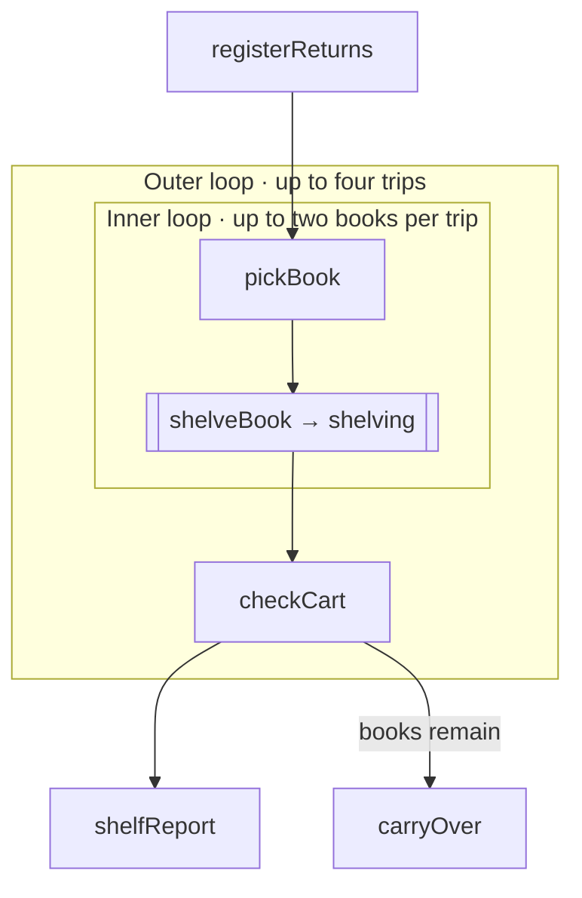

<p align="center">
  
</p>

<h1 align="center">Ditto</h1>

<p align="center">
  A lightweight Node Runtime graphs for composable Agent system.<br />
  Scale Workers without changing Graphs or Node Contracts.
</p>

<p align="center">
  <strong>English</strong> | <a href="https://github.com/erwinmsmith/Ditto/blob/main/README.zh-CN.md">简体中文</a>
</p>

[Start the web graph editor](#start-the-web-graph-editor) · **[Build a complete Agent from scratch](docs/agent-from-zero.md)** · [Configuration reference](docs/agent-json.md) · [Developer handbook](docs/handbook/index.md)

## Install and use

Requires Node.js 24+ and npm 11+. The configuration-based Agent API and template below require `@codesoul-co/ditto@0.1.5` or later.

```sh
npm init -y
npm pkg set type=module
npm install @codesoul-co/ditto
```

Start with the standard root template [agent_example.json](agent_example.json). It includes main, a Subgraph, a Loop and Worker registration/bindings; edit ordinary parameters in `config`. After npm installation, copy it:

```sh
cp node_modules/@codesoul-co/ditto/agent_example.json agent.json
```

## Start the web graph editor

From the root of the **Ditto source checkout** with Node.js 24+ and npm 11+, install dependencies once and start the editor:

```sh
npm ci
npm run editor
```

Open the address printed in the terminal, normally [http://127.0.0.1:4317](http://127.0.0.1:4317). Keep that terminal running while you edit. The default canvas opens `agent_example.json`. Use **Import JSON** to open a definition in a new canvas, and **Save JSON** to export it. Click the filename to open **Canvas history**. Each row has a **Delete canvas** action that removes its local draft, layout and conversations after confirmation. Layout and conversations are kept in your browser. For open-ended chat, choose a provider, model and API key in the sidebar settings. Canvas editing works without a model key.

In the node library, choose a Worker category to see its nodes. Right-click the canvas to insert a node or subgraph, or right-click a wire to delete it. Drag ports to connect nodes. Wires start unconditional and can be edited by double-clicking. Use **Repeat nodes** to loop over a path or a single subgraph call. The sidebar also accepts Markdown attachments.

### Full example · Museum visitor desk (5 Workers, 22 node types)

Choose **Import JSON → Museum visitor desk · 5 Workers**, or start directly on the [museum Agent JSON](editor/examples/museum/agent.json):

```sh
npm run editor -- editor/examples/museum/agent.json
```

A family of three and a group of five ask about tickets and access to the fossil gallery. The desk consults a guide, checks today's entrance notice and calculates each group's fare. It sends a reviewed reply to a local Markdown file or puts the case in the staff review queue. You can explore the whole graph on the canvas before connecting any services.

The main canvas processes the queue directly. Open the two subgraphs, `draftAndReview` and `disposition`, for the drafting pipeline and the visitor/staff delivery decision. The three colored loops in **main** can each be edited on the canvas:

| Loop | When it repeats | When it stops |
| --- | --- | --- |
| `nextVisitor → checkQueue` | Pick a waiting group, prepare the reply, deliver it and archive the case. | The SQLite queue is empty, or 12 groups have been processed. |
| `dailyNotice ↺` | Retry the read-only MCP bulletin call when it returns an unsuccessful tool result. | The bulletin is available, or three attempts are used. An unsuccessful final result stops the run before drafting. |
| `reviewReply ↺` | Use the cached feedback to rewrite a reply that failed verification. | Verification passes, or the second draft goes to the delivery decision. |

The two sample groups exercise the queue loop twice. Reduce its limit to one and run the exported definition to see one completed report and `remainingCount: 1`.

| Worker | Nodes used | Role in the task |
| --- | --- | --- |
| CONTEXT (4) | LOAD, UPDATE, COMPRESS, SELECT | Load the question, add evidence, trim the Redis working set and select model messages. |
| MEMORY (6) | WRITE, SEARCH, UPDATE, GET, DELETE, QUERY | Open a temporary case in SQLite, search earlier approved answers, update and read back the draft, archive it, remove only that case’s scratch record and count approved cases. |
| INFER (7) | REASONING.SAMPLE, REASONING.TRAJECTORY, REASONING.DELIBERATE, REASONING.REFLECT, CACHE.LOOKUP, CACHE.WRITE, CACHE.INVALIDATE | Generate a direct and a multi-step draft, select one, verify it, carry feedback to a retry and expire the case cache after archiving. |
| INTERACTION (4) | ACT.MCP, OBSERVE, ACT.TOOL, OUTPUT | Read the daily bulletin through MCP, normalize it, calculate the fare with a local tool and write the selected delivery. |
| RETRIEVAL (1, optional package) | SEARCH | Search the museum guide for opening times and accessible routes. |

**Run the system.** Use the source checkout with `npm ci` completed. Execution uses the workspace retrieval package, a Redis server (default `127.0.0.1:6379`, configurable via `DITTO_WORKER_CONTEXT_REDIS_URL`) and a configured model provider. Configure the project's inference provider and credentials using the [model setup guide](docs/agent-from-zero.md). Start Redis, then run from the repository root:

```sh
npm ci --prefix examples/_shared/tools/storage/dependencies
npm ci --prefix editor/examples/museum
node --env-file-if-exists=.env editor/examples/museum/run.mjs
```

The [runner](editor/examples/museum/run.mjs) starts a local MCP client and server connected through the SDK’s in-process transport. Each run creates a fresh directory with `memory.sqlite` and `answers/`. The expected fares are **USD 29** for the family and **USD 32** for the group. Check the reported `approved` and `delivery` fields to see which branch actually ran. A rejected case writes reviewer feedback to a file ending in `-review.md`. Change the [visitor requests, prices or bulletin](editor/examples/museum/venue.json) to try different inputs. To execute a canvas edit, save the JSON and append `--definition path/to/saved.json` to the runner command.

### Worked example · Library returns

Open **Import JSON → Try the library returns example**. To start the editor directly on the same file, use this command in place of `npm run editor`:

```sh
npm run editor -- editor/examples/library-returns.json
```

The library receives a cart of books. Each trip can shelve two books, and staff have time for four trips. The agent produces a shelf report and, when books remain, a handoff list for the next shift. The [agent definition](editor/examples/library-returns.json) describes the workflow. The [runner](editor/examples/run-library-returns.mjs) supplies a MEMORY Worker backed by a fresh local SQLite database.



1. **Register.** `registerReturns` writes one record per title under the current batch ID. `pickBook` selects one returned book from that batch.
2. **Shelve.** On the `shelveBook` node, click the stacked-layers button **Open subgraph · shelving**. Its `markShelved` node updates the book's status and `writeReceipt` records its title and ID. The subgraph returns `lastBook`, which ends the inner loop early when this was the final book.
3. **Check and report.** After each trip, `checkCart` checks for remaining books. An empty cart ends the outer loop early. At the end, `shelfReport` lists the shelved books. Double-click the `checkCart → carryOver` wire to inspect the condition that generates the handoff list only when books remain.

Run the same JSON from a second terminal at the repository root:

```sh
node editor/examples/run-library-returns.mjs
node editor/examples/run-library-returns.mjs A B C D E F G H I
```

| Input | Trips | Shelved | Remaining | `complete` |
| --- | ---: | ---: | ---: | --- |
| Five default titles | 3 | 5 | 0 | `true` |
| Nine titles | 4 | 8 | 1 | `false` |

**Try an edit.** In `main`, click the colored `pickBook → checkCart` loop label and raise its maximum from 4 to 5. Choose **Save JSON**. Run the exported file by supplying its path:

```sh
node editor/examples/run-library-returns.mjs --definition path/to/saved.json A B C D E F G H I
```

All nine books now fit in five trips. The output includes `remaining: []`, `complete: true`, and the SQLite file path.

### Standard Agent JSON template

In the source repository, use `cp agent_example.json agent.json`. The complete configuration follows: an outer Loop runs main, main invokes the load-context Subgraph and then SELECT, and deployment registers and binds the Worker.

```json
{
  "version": 1,
  "id": "agent-example",
  "config": { "selectionLimit": 1, "repetitions": 1 },
  "graphs": {
    "main": {
      "nodes": [
        {
          "id": "prepare", "kind": "subgraph", "graph": "load-context",
          "input": { "$ref": "input" }
        },
        {
          "id": "selected", "type": "CONTEXT.SELECT", "dependsOn": ["prepare"],
          "input": {
            "context": { "$ref": "nodes.prepare" }, "purpose": "infer",
            "limit": { "$ref": "config.selectionLimit" }
          }
        }
      ],
      "output": { "$ref": "nodes.selected.context.items.0.content" }
    },
    "load-context": {
      "nodes": [{
        "id": "loaded", "type": "CONTEXT.LOAD",
        "input": { "sources": [{ "role": "user", "content": { "$ref": "input" } }] }
      }],
      "output": { "$ref": "nodes.loaded" }
    }
  },
  "loop": {
    "entry": "prepare", "maxIterations": 8,
    "state": { "round": 0, "result": null },
    "steps": {
      "prepare": {
        "graph": "main", "input": { "$ref": "input" },
        "assign": {
          "round": { "$op": "add", "args": [{ "$ref": "state.round" }, 1] },
          "result": { "$ref": "result" }
        },
        "transitions": [
          {
            "when": { "$op": "gte", "args": [{ "$ref": "state.round" }, { "$ref": "config.repetitions" }] },
            "end": "completed"
          },
          { "next": "prepare" }
        ]
      }
    },
    "output": { "$ref": "state.result" }
  },
  "deployment": {
    "workers": [{ "id": "context", "use": "context" }],
    "bindings": {
      "main": { "prepare/loaded": "context", "selected": "context" }
    }
  }
}
```

The default is one iteration; set `config.repetitions` to `2` for two. `loop.maxIterations` bounds total Graph executions. Save these runtime settings as `ditto.yaml`:

```yaml
runtime:
  graphConcurrency: 4
workers:
  context:
    policy:
      maxItems: 256
```

Save the host as `app.mjs`, then run `node app.mjs`:

```js
import { readFile } from "node:fs/promises";
import { createAgent } from "@codesoul-co/ditto/runtime";
import { createContextWorker } from "@codesoul-co/ditto/worker/context";

const definition = JSON.parse(await readFile("agent.json", "utf8"));
const agent = await createAgent(definition, {
  workers: { context: createContextWorker() },
});
try { console.log(await agent.run("Hello Ditto")); }
finally { await agent.close(); }
```

| Configuration | Responsibility |
| --- | --- |
| `agent.json` | main, Subgraphs, Node dependencies, Loop transitions/stopping, application parameters and Worker bindings |
| `ditto.yaml` | Runtime and Worker behavior defaults, loaded automatically when creating an Agent / Runtime |
| `.env` | Credentials, endpoints, model selection and deployment permissions; load with `node --env-file=.env app.mjs` when needed |

`createAgent()` / `createDitto()` automatically read `ditto.yaml` from the current working directory (`process.cwd()`) and combine it with the existing `process.env`; no manual loader call or parent-directory search is needed. A missing default file falls back to environment values and built-in defaults; malformed settings and other read errors fail immediately. Each Runtime reads its configuration once at startup, not on every Node call. An explicit `config` completely bypasses automatic loading. Use `config: loadRuntimeConfigFile("path/to/ditto.yaml")` for a custom path or `config: loadRuntimeConfig({})` for built-in defaults only. Load `.env` separately through the application or `node --env-file=.env`; importing the package and calling `compileAgent()` do not read files.

Precedence depends on the parameter; the two files are not merged wholesale:

| Parameter | Effective order (leftmost wins) |
| --- | --- |
| Runtime configuration source | Explicit `createAgent(..., { config })` / `createDitto({ config })` → automatic `./ditto.yaml` and process environment → built-in field defaults |
| Loop budget | `agent.json.loop.maxIterations`, required when `loop` is present. YAML `runtime.loopMaxIterations` only supplies a fallback for code-based Loops without an explicit budget; an Agent without `loop` runs main once |
| Graph concurrency | `agent.run(input, { concurrency })` → YAML `runtime.graphConcurrency` → built-in `Infinity` |
| Memory query limit | Node input `limit` (which can be set in `agent.json`) → Worker factory `defaults.queryLimit` → YAML `workers.memory.queryLimit` → built-in `100` |
| Application parameters | `agent.json.config` is only available through `$ref: "config.…"`; it does not override YAML or the host's Runtime `config` |
| Context policy | Explicit Worker factory `policy` fields → YAML `workers.context.policy` → built-in defaults; `createContextWorker()` uses Runtime policy automatically |

Environment variables supply credentials, addresses, model selection and deployment permissions; YAML supplies behavior defaults. They own different fields, with no universal “environment overrides JSON/YAML” rule. Other Node parameters follow their respective contracts; default overrides cannot grant tool permissions. The host still creates and injects databases, tools and service profiles.

### From zero to a complete Agent: resources, JSON and deployment

Follow [Run a complete Agent from scratch, then deploy remote Workers](docs/agent-from-zero.md). This path uses five Workers, a real model, Redis, SQLite and tool execution. Its 13-node main Graph is orchestrated entirely by `agent.json`.

| Worker | Where resources are connected |
| --- | --- |
| Context | Connect an application Redis client and pass it to `createContextWorker({ redis: { client } })` |
| Memory | Supply a SQLite / other database `MemoryStore` through `createMemoryWorker({ store })` |
| Infer | Configure model endpoint, key, model name and network permission in `.env`; Runtime builds the HTTP Provider |
| Interaction | Register tool implementations, an OutputSink and permitted-tool service profiles in the host |
| Retrieval | Install the separate package and inject a file / vector-service search Provider |

Download application examples into an empty directory and install published npm packages:

```sh
mkdir my-ditto-agent
cd my-ditto-agent
curl -fL https://codesoul-co.github.io/Ditto/downloads/ditto-examples.zip -o examples.zip
unzip -q examples.zip
npm install
cp examples/package-basics/.env.example .env
cp examples/json-agent/npm-scenarios/single/ditto.example.yaml ditto.yaml
cp examples/json-agent/npm-scenarios/single/agent.json agent.json
cp examples/json-agent/npm-scenarios/single/input.example.json input.json
mkdir -p task
cp examples/json-agent/npm-scenarios/single/guide.example.json task/guide.json
```

Fill in real model credentials, the permitted network origin and Redis URL in `.env`, then start Redis. The application creates SQLite automatically; this five-Worker path needs no third-party extension. Run:

```sh
node --env-file=.env examples/json-agent/npm-scenarios/cli.mjs agent.json input.json task
cat task/answers/demo-1.md
```

Expect `3`, with a real tool call, Redis Context, `task/memory.sqlite` and an answer file. Use fresh business IDs for each new task. `openScenarioResources()` in [host.ts](examples/json-agent/npm-scenarios/host.ts) opens resources and builds Workers once; the CLI reads JSON and calls `createAgent()` / `agent.run()`. Resource adapters are application source, not built-in Core database connections.

For a long-running service, create resources and the Agent at startup, reuse `agent.run(input)` per request, then drain the Agent before closing Redis/database clients. JSON selects host implementations through `deployment.workers[].use` and instances through `bindings`; it does not implement tools or grant itself permissions.

**Keep the same JSON when deploying across machines.** [remote.mjs](examples/json-agent/npm-scenarios/remote.mjs) provides runnable HTTP server/controller modes. The server owns resources and five registered Workers; the controller uses `compileAgent()`, `createHttpTransport()` and `registerRemote()` to execute the plan. Graph/Loop stay on the controller, Node calls cross HTTP(S), and databases/model keys stay on the execution host. IPC is available for local child processes. See the [complete deployment steps](docs/agent-from-zero.md#6-move-the-same-json-to-http-workers) for tokens, TLS, manifests, shutdown and communication limits; `agent.json` does not automatically deploy or discover remote services.

Configured Agents also support independent Graph/Subgraph execution, durable checkpoints, awaited state-update/pause boundaries, and editor schemas, diagnostics and node mappings. See the [execution and recovery guide](docs/agent-execution.md) for APIs available in `0.1.5` and later.

This first Graph requires no model, Redis or credentials. For a complete Agent, use real model configuration, Redis Context and database Memory as shown in the [detailed package guide](https://github.com/erwinmsmith/Ditto/blob/main/docs/package-guide.md) ([中文](https://github.com/erwinmsmith/Ditto/blob/main/docs/package-guide.zh-CN.md)). It covers installation, strict TypeScript, every execution entry, result handling, tools, Loop composition, storage, recovery, output and troubleshooting.

The [four runnable beginner examples](https://github.com/erwinmsmith/Ditto/tree/main/examples/package-basics) demonstrate Context, tools, optional retrieval and a persistent multi-turn Agent. The guide includes exact commands to copy application adapters into an independent npm project; example business functions are not package exports.

Install retrieval separately when needed:

```sh
npm install @codesoul-co/ditto-retrieval
```

Import its Worker from `@codesoul-co/ditto-retrieval`. Runtime and built-in Worker entries such as `@codesoul-co/ditto/runtime` and `@codesoul-co/ditto/worker/memory` belong to the main package. Do not import private `src` or `dist` paths.

The standard construction path uses a configuration file, currently in JSON format: `agent.json` owns the required `main`, optional Subgraphs, outer Loop, Worker registration references and bindings. The host supplies implementations, credentials and permissions. See the [configuration guide](docs/agent-json.md) and [configuration examples](examples/json-agent/README.md). Code-based composition and provider wiring below are advanced integration paths.

## Architecture

Ditto separates four concepts:

- **Node**: the smallest routable semantic operation;
- **Worker**: the implementation, resource, deployment, and scaling boundary;
- **Execution Graph**: a location-independent composition of Nodes;
- **Runtime**: scheduling, routing, communication, and execution.

Changing a model, database, tool Provider, deployment location, or replica count does not create a new Node Type. Runtime communication uses `invoke` for request/response and `emit` for asynchronous events; neither is an Interaction Node.

## Final Node Domains

- `INFER.REASONING.*`: explicit reasoning organization (`TRAJECTORY`, `REFLECT`, `DELIBERATE`, `SAMPLE`);
- `INFER.CACHE.*`: inference cache `LOOKUP`, `WRITE`, and `INVALIDATE`;
- `CONTEXT.*`: the current invocation/turn working set, including task-local RAG and activated Skills;
- `MEMORY.*`: durable storage and search through GET / QUERY / SEARCH / WRITE / UPDATE / DELETE;
- `INTERACTION.ACT.TOOL` / `INTERACTION.ACT.MCP`: external actions;
- `INTERACTION.OBSERVE` / `INTERACTION.OUTPUT`: normalized observations and final output.

`INFER/PROVIDERS` is an implementation directory, not a Node. `INFER/REASONING` is also a source directory rather than a `REASONING` Node. Inject tools through `createInteractionWorker({ tools, mcp, output })`; individual tools, Linux commands, and web search providers do not create additional Node Types. `createReadOnlyCommandTools()` offers 14 optional bounded search, reading, text-processing, metadata, disk-usage, and workspace-location commands. `createWebSearchTool()` accepts an application-injected provider; `createBraveWebSearchProvider()` is the first native-fetch adapter. Neither helper is registered or permitted by default.

RETRIEVAL is an optional independently deployable search Worker exposing only `RETRIEVAL.SEARCH`. Import and register `@codesoul-co/ditto-retrieval` explicitly; Core does not load it by default. Existing direct MEMORY/CONTEXT providers remain available. See the [RETRIEVAL API](https://github.com/erwinmsmith/Ditto/blob/main/docs/worker-api/retrieval.md).

## Predefined Runtime Flows

Four public compositions live directly in `src/runtime/graph.ts` and are exported from `@codesoul-co/ditto/runtime`:

```text
runRagFlow          CONTEXT.SELECT (rag strategy)
runSkillFlow        CONTEXT.LOAD -> CONTEXT.UPDATE (when context is supplied)
runToolCallFlow      INTERACTION.ACT.TOOL   -> INTERACTION.OBSERVE -> CONTEXT.UPDATE
runMcpFlow           INTERACTION.ACT.MCP    -> INTERACTION.OBSERVE -> CONTEXT.UPDATE (invoke)
```

These Runtime functions use explicit Context. RAG is an internal SELECT strategy; applications resolve Skill content for LOAD/UPDATE. See the [CONTEXT API](https://github.com/erwinmsmith/Ditto/blob/main/docs/worker-api/context.md) for cached calls, Redis and examples.

```ts
import { runRagFlow, runToolCallFlow } from "@codesoul-co/ditto/runtime";

const retrieved = await runRagFlow(runtime, {
  context: { items: [] },
  query: "Find the relevant API definition",
  corpus: { uri: "urn:contracts" }, // Resolved by the configured ragStrategy.
});

const toolResult = await runToolCallFlow(runtime, {
  context: retrieved.context,
  call: { id: "read-1", name: "read_text", arguments: { path: "README.md" } },
});
```

## Graphs and Workers

Graphs contain semantic Node Types and data bindings, never Worker IDs or network addresses:

```ts
import { randomUUID } from "node:crypto";
import { graph, type Message } from "@codesoul-co/ditto";

const review = graph<Message>("review")
  .node("memories", "MEMORY.GET", [], () => ({
    keys: ["review-policy"],
  }))
  .node("context", "CONTEXT.LOAD", ["memories"], (query, { memories }) => {
    if (memories.status !== "success" || !memories.output) throw new Error("Memory read failed");
    return { sources: [query, ...memories.output.map(memory => ({
      id: memory.id, content: typeof memory.content === "string" ? memory.content : JSON.stringify(memory.content),
    }))] };
  })
  .node("reason", "INFER.REASONING.TRAJECTORY", ["context"], (_query, { context }) => ({
    messages: [{ role: _query.role, content: typeof _query.content === "string"
      ? _query.content : JSON.stringify(_query.content) }],
    context: context.items.map(item => ({ id: item.id, content: item.content })),
    model: { model: "your-model-name" },
    strategy: { name: "cot" },
  }))
  .node("output", "INTERACTION.OUTPUT", ["reason"], (_query, { reason }) => {
    if (reason.status !== "success" || reason.output?.status !== "completed") {
      throw new Error(reason.error?.message ?? "Trajectory incomplete");
    }
    return { deliveryId: randomUUID(), message: { role: reason.output.result.role,
      content: typeof reason.output.result.content === "string"
        ? reason.output.result.content : JSON.stringify(reason.output.result.content) } };
  });
```

Registering more Worker replicas adds capacity without changing this Graph. The same contracts support local execution, multiple Workers, multiple processes, or custom remote transports.

See the [INFER Worker API](https://github.com/erwinmsmith/Ditto/blob/main/docs/worker-api/infer.md) for setup and all seven leaf contracts.

Define an Agent with Graph → Loop → Worker; run the complete [graph-loop-worker.ts](https://github.com/erwinmsmith/Ditto/blob/main/docs/worker-api/examples/graph-loop-worker.ts) example using `npm run example:agent`. See [Interaction setup](https://github.com/erwinmsmith/Ditto/blob/main/docs/interaction-runtime.md#graph-loop-and-worker-setup) for Tool and MCP wiring.

## Repository Structure

```text
src/
├── contracts/                    # shared fixed types and open NodeContractMap
├── runtime/
│   ├── graph.ts                  # DAG plus four predefined flows
│   ├── runtime.ts                # routing and lifecycle
│   └── communication/            # invoke/emit, transports, artifacts
└── worker/
    ├── infer/
    │   ├── reasoning/            # reasoning leaves and node scaffolds
    │   ├── cache/                # LOOKUP / WRITE / INVALIDATE
    │   └── providers/            # shared provider registry and wire protocols
    ├── context/
    ├── memory/
    └── interaction/act/tool/     # Tool Node, registry, implementation folders
```

The optional SEARCH Worker lives in `packages/retrieval/` and is published separately as `@codesoul-co/ditto-retrieval`.

Core uses only the `yaml` parser as a third-party runtime dependency. Heavy RPC, event buses, MCP SDKs, database drivers, and model SDKs remain optional application/adapter choices.

## Development

Requirements: Node.js 24+ and npm 11+.

```bash
npm ci
npm run check
```

Install the Runtime with `npm install @codesoul-co/ditto`. Applications that use the optional search Worker also install `@codesoul-co/ditto-retrieval`.

See the [Runtime API](https://github.com/erwinmsmith/Ditto/blob/main/docs/worker-api/runtime.md) and [complete examples](https://github.com/erwinmsmith/Ditto/blob/main/docs/worker-api/examples/runtime/README.md) for node bindings, independent sandboxes, loops and local IPC / cross-host HTTP.

## Documentation

- [Examples: control flow, capabilities and execution patterns](https://github.com/erwinmsmith/Ditto/blob/main/examples/README.md) (run `npm run example:quickstart` for a local introduction)
- [Node System and API Contract](https://github.com/erwinmsmith/Ditto/blob/main/docs/13-node-api-contract.md)
- [Architecture and extension boundaries](https://github.com/erwinmsmith/Ditto/blob/main/docs/architecture.md)
- [Development and package integration](https://github.com/erwinmsmith/Ditto/blob/main/docs/getting-started.md)
- [Worker communication and deployment](https://github.com/erwinmsmith/Ditto/blob/main/docs/worker-communication.md)
- [Providers, Interaction, and predefined flows](https://github.com/erwinmsmith/Ditto/blob/main/docs/interaction-runtime.md)

Use [GitHub Issues](https://github.com/erwinmsmith/Ditto/issues) for concrete use cases, bugs, and architecture discussions.

Behavior defaults live in root [`ditto.yaml`](https://github.com/erwinmsmith/Ditto/blob/main/ditto.yaml); credentials and deployment bindings use [`.env.example`](https://github.com/erwinmsmith/Ditto/blob/main/.env.example). All Workers share Runtime services; see the [configuration API](https://github.com/erwinmsmith/Ditto/blob/main/docs/worker-api/configuration.md). See the [INFER example guide](https://github.com/erwinmsmith/Ditto/blob/main/docs/worker-api/examples/guide.md#infer) for setup and commands.

See the [MEMORY API](https://github.com/erwinmsmith/Ditto/blob/main/docs/worker-api/memory.md) for plugin wiring, six node contracts and configuration.

More public APIs and examples: [Worker composition / events / Artifacts](https://github.com/erwinmsmith/Ditto/blob/main/docs/worker-api/composition.md), [predefined flows](https://github.com/erwinmsmith/Ditto/blob/main/docs/worker-api/flows.md), and the [local quickstart](https://github.com/erwinmsmith/Ditto/blob/main/examples/quickstart.ts).

Portable JSON checkpoints, isolated state branches and shared token budgets are available from the root package. See [checkpoint and budget contracts](https://github.com/erwinmsmith/Ditto/blob/main/docs/worker-api/checkpoints.md) for examples and external-resource limitations.
