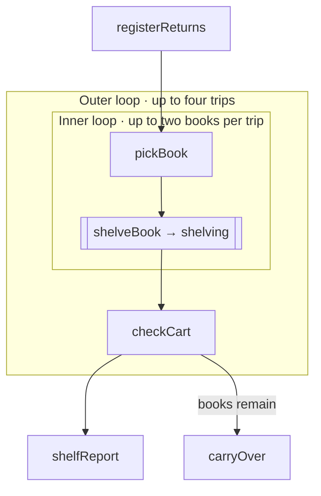

# Graph editor examples

## Full example · Museum visitor desk (5 Workers, 22 node types)

Choose **Import JSON → Museum visitor desk · 5 Workers**, or start directly on the [museum Agent JSON](../editor/examples/museum/agent.json):

```sh
npm run editor -- editor/examples/museum/agent.json
```

A family of three and a group of five ask about tickets and access to the fossil gallery. The desk consults a guide, checks today's entrance notice and calculates each group's fare. It sends a reviewed reply to a local Markdown file or puts the case in the staff review queue. You can explore the whole graph on the canvas before connecting any services.

The main canvas processes the queue directly. Open the two subgraphs, `draftAndReview` and `disposition`, for the drafting pipeline and the visitor/staff delivery decision. The three colored loops in **main** can each be edited on the canvas:

| Loop | When it repeats | When it stops |
| --- | --- | --- |
| `nextVisitor → checkQueue` | Pick a waiting group, prepare the reply, deliver it and archive the case. | The SQLite queue is empty, or 12 groups have been processed. |
| `dailyNotice ↺` | Retry the read-only MCP bulletin call when it returns an unsuccessful tool result. | The bulletin is available, or three attempts are used. An unsuccessful final result stops the run before drafting. |
| `reviewReply ↺` | Use the cached feedback to rewrite a reply that failed verification. | Verification passes, or the second draft goes to the delivery decision. |

The two sample groups exercise the queue loop twice. Reduce its limit to one and run the exported definition to see one completed report and `remainingCount: 1`.

| Worker | Nodes used | Role in the task |
| --- | --- | --- |
| CONTEXT (4) | LOAD, UPDATE, COMPRESS, SELECT | Load the question, add evidence, trim the Redis working set and select model messages. |
| MEMORY (6) | WRITE, SEARCH, UPDATE, GET, DELETE, QUERY | Open a temporary case in SQLite, search earlier approved answers, update and read back the draft, archive it, remove only that case’s scratch record and count approved cases. |
| INFER (7) | REASONING.SAMPLE, REASONING.TRAJECTORY, REASONING.DELIBERATE, REASONING.REFLECT, CACHE.LOOKUP, CACHE.WRITE, CACHE.INVALIDATE | Generate a direct and a multi-step draft, select one, verify it, carry feedback to a retry and expire the case cache after archiving. |
| INTERACTION (4) | ACT.MCP, OBSERVE, ACT.TOOL, OUTPUT | Read the daily bulletin through MCP, normalize it, calculate the fare with a local tool and write the selected delivery. |
| RETRIEVAL (1, optional package) | SEARCH | Search the museum guide for opening times and accessible routes. |

**Run the system.** Use the source checkout with `npm ci` completed. Execution uses the workspace retrieval package, a Redis server (default `127.0.0.1:6379`, configurable via `DITTO_WORKER_CONTEXT_REDIS_URL`) and a configured model provider. Configure the project's inference provider and credentials using the [model setup guide](agent-from-zero.md). Start Redis, then run from the repository root:

```sh
npm ci --prefix examples/_shared/tools/storage/dependencies
npm ci --prefix editor/examples/museum
node --env-file-if-exists=.env editor/examples/museum/run.mjs
```

The [runner](../editor/examples/museum/run.mjs) starts a local MCP client and server connected through the SDK’s in-process transport. Each run creates a fresh directory with `memory.sqlite` and `answers/`. The expected fares are **USD 29** for the family and **USD 32** for the group. Check the reported `approved` and `delivery` fields to see which branch actually ran. A rejected case writes reviewer feedback to a file ending in `-review.md`. Change the [visitor requests, prices or bulletin](../editor/examples/museum/venue.json) to try different inputs. To execute a canvas edit, save the JSON and append `--definition path/to/saved.json` to the runner command.

## Worked example · Library returns

Open **Import JSON → Try the library returns example**. To start the editor directly on the same file, use this command in place of `npm run editor`:

```sh
npm run editor -- editor/examples/library-returns.json
```

The library receives a cart of books. Each trip can shelve two books, and staff have time for four trips. The agent produces a shelf report and, when books remain, a handoff list for the next shift. The [agent definition](../editor/examples/library-returns.json) describes the workflow. The [runner](../editor/examples/run-library-returns.mjs) supplies a MEMORY Worker backed by a fresh local SQLite database.



1. **Register.** `registerReturns` writes one record per title under the current batch ID. `pickBook` selects one returned book from that batch.
2. **Shelve.** On the `shelveBook` node, click the stacked-layers button **Open subgraph · shelving**. Its `markShelved` node updates the book's status and `writeReceipt` records its title and ID. The subgraph returns `lastBook`, which ends the inner loop early when this was the final book.
3. **Check and report.** After each trip, `checkCart` checks for remaining books. An empty cart ends the outer loop early. At the end, `shelfReport` lists the shelved books. Double-click the `checkCart → carryOver` wire to inspect the condition that generates the handoff list only when books remain.

Run the same JSON from a second terminal at the repository root:

```sh
node editor/examples/run-library-returns.mjs
node editor/examples/run-library-returns.mjs A B C D E F G H I
```

| Input | Trips | Shelved | Remaining | `complete` |
| --- | ---: | ---: | ---: | --- |
| Five default titles | 3 | 5 | 0 | `true` |
| Nine titles | 4 | 8 | 1 | `false` |

**Try an edit.** In `main`, click the colored `pickBook → checkCart` loop label and raise its maximum from 4 to 5. Choose **Save JSON**. Run the exported file by supplying its path:

```sh
node editor/examples/run-library-returns.mjs --definition path/to/saved.json A B C D E F G H I
```

All nine books now fit in five trips. The output includes `remaining: []`, `complete: true`, and the SQLite file path.
