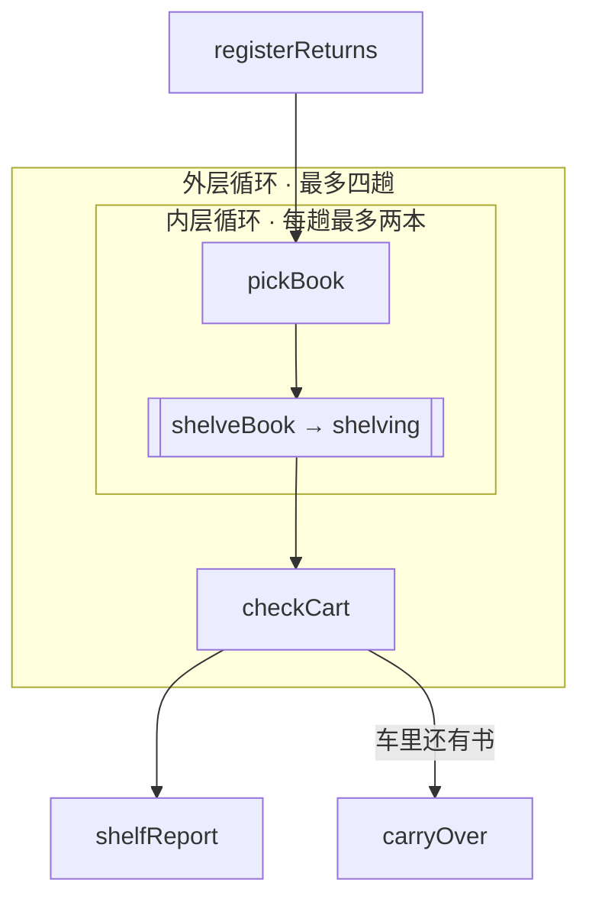

# 编排编辑器示例

## 完整示例 · 博物馆访客咨询（5 类 Worker、22 种节点）

点击 **导入 JSON → 博物馆访客咨询 · 5 类 Worker**，英文页面对应 **Import JSON → Museum visitor desk · 5 Workers**。也可以直接用[博物馆 Agent JSON](../editor/examples/museum/agent.json)启动画布。

```sh
npm run editor -- editor/examples/museum/agent.json
```

一个三口之家和一个五人小组来咨询化石展。服务台要查开放时间和无障碍路线、读取当天的入口公告、计算各组票价，并把审核通过的答复写成 Markdown。如果两次起草都未通过审核，就给工作人员留一份待复核意见。浏览和编辑画布可以直接开始，运行整套系统时再连接下方资源。

主画布直接展示取号、读取公告、报价、起草、交付和归档。只有起草审核（`draftAndReview`）与交付分流（`disposition`）收进了子图，点击节点上的叠层图标即可展开查看。**三段不同颜色的循环都在 main 里**，可以点击各自的循环标签修改。

| 循环 | 重复什么 | 何时停止 |
| --- | --- | --- |
| `nextVisitor → checkQueue` | 从 SQLite 队列取一组访客，处理答复、交付并归档。 | 队列为空，或已处理 12 组。 |
| `dailyNotice ↺` | MCP 公告工具返回失败状态时重读公告。 | 成功即停，最多读三次。最后一次仍失败时停止本次运行。 |
| `reviewReply ↺` | 答复未通过审核时，读取缓存里的意见重新起草。 | 审核通过或已起草两次，再按结果发给访客或转人工。 |

默认的两组访客会实际走两轮队列循环。把上限改为 1，再用导出的 JSON 运行，就能看到一份已完成报告和 `remainingCount: 1`。

| Worker | 用到的节点 | 在任务里的职责 |
| --- | --- | --- |
| CONTEXT（4） | LOAD、UPDATE、COMPRESS、SELECT | 载入问题，将证据加入 Redis 上下文，按预算裁剪并选出给模型的消息。 |
| MEMORY（6） | WRITE、SEARCH、UPDATE、GET、DELETE、QUERY | 在 SQLite 建临时工单，搜索已批准的历史答复，更新并回读草稿，保存归档，仅删除本工单的临时记录，最后统计已批准案例。 |
| INFER（7） | REASONING.SAMPLE、REASONING.TRAJECTORY、REASONING.DELIBERATE、REASONING.REFLECT、CACHE.LOOKUP、CACHE.WRITE、CACHE.INVALIDATE | 并行生成直接答复与多步规划稿，比较候选并核对事实，用缓存传递复审意见，结案后清理对应缓存键。 |
| INTERACTION（4） | ACT.MCP、OBSERVE、ACT.TOOL、OUTPUT | 通过 MCP 读当天公告，转换为观察消息，用本地工具算票价，将答复或复核意见写入对应文件。 |
| RETRIEVAL（1，可选包） | SEARCH | 从博物馆指南检索开放时间和无障碍路线。 |

**运行完整系统。** 先在源码仓库根目录完成 `npm ci`。运行时使用工作区的可选检索包、Redis 和真实模型。启动 Redis（默认地址为 `127.0.0.1:6379`，可通过 `DITTO_WORKER_CONTEXT_REDIS_URL` 指定），按[模型配置指南](agent-from-zero.zh-CN.md)设置项目的模型与凭据，然后在仓库根目录执行：

```sh
npm ci --prefix examples/_shared/tools/storage/dependencies
npm ci --prefix editor/examples/museum
node --env-file-if-exists=.env editor/examples/museum/run.mjs
```

[运行脚本](../editor/examples/museum/run.mjs)通过 SDK 的进程内传输连接本地 MCP 客户端与服务端。每次运行都会打印独立目录，其中有 `memory.sqlite` 和 `answers/`。按示例票价，家庭票应为 **29 美元**，小组票应为 **32 美元**。查看输出的 `approved` 和 `delivery` 可以确认实际走了哪条分支，转人工时文件名以 `-review.md` 结尾。可以修改[访客问题、票价或公告](../editor/examples/museum/venue.json)再运行。要执行画布上修改过的版本，在运行命令后加 `--definition path/to/saved.json` 指向导出的文件。

## 局部循环示例 · 图书归还上架

在英文页面选择 **Import JSON → Try the library returns example**，中文页面对应 **导入 JSON → 试用「图书归还上架」示例**。也可以在启动时直接指定示例文件。

```sh
npm run editor -- editor/examples/library-returns.json
```

图书馆收到一车还书。管理员每趟最多上架两本，一个班次最多跑四趟。Agent 要列出已上架的书，若车里还有书，再为下一班生成交接清单。[Agent 定义](../editor/examples/library-returns.json)描述编排，[运行脚本](../editor/examples/run-library-returns.mjs)负责注册 MEMORY Worker，每次运行使用独立的本地 SQLite 数据库。



1. **登记还书。** `registerReturns` 给本批次的每本书写一条归还记录，`pickBook` 从中取一本待上架的书。
2. **进入上架子图。** 点击 `shelveBook` 节点上的叠层图标「进入子图 · shelving」。子图里的 `markShelved` 更新书的状态，`writeReceipt` 写入带书名和记录 ID 的回执。子图返回 `lastBook`。如果上架的是最后一本，内层循环就提前结束。
3. **检查并交接。** 每趟结束时，`checkCart` 检查车里是否还有书。车空就提前结束外层循环。结束后，`shelfReport` 列出已上架的书。双击 `checkCart → carryOver` 连线可以查看条件，只有车里还有书才会生成交接清单。

在仓库根目录另开一个终端，分别运行两批书。

```sh
node editor/examples/run-library-returns.mjs
node editor/examples/run-library-returns.mjs A B C D E F G H I
```

| 输入 | 趟数 | 已上架 | 待交接 | `complete` |
| --- | ---: | ---: | ---: | --- |
| 默认的五本书 | 3 | 5 | 0 | `true` |
| 指定的九本书 | 4 | 8 | 1 | `false` |

**试着改一次编排。** 在 `main` 画布上点击彩色的 `pickBook → checkCart` 循环标签，把最多趟数从 4 改成 5，点击「保存 JSON」。将下面的路径替换为刚刚导出的文件，再用同样的九本书运行。

```sh
node editor/examples/run-library-returns.mjs --definition path/to/saved.json A B C D E F G H I
```

这次五趟刚好能上架九本书。输出中会看到 `remaining: []`、`complete: true`，以及可查看回执的 SQLite 文件路径。
